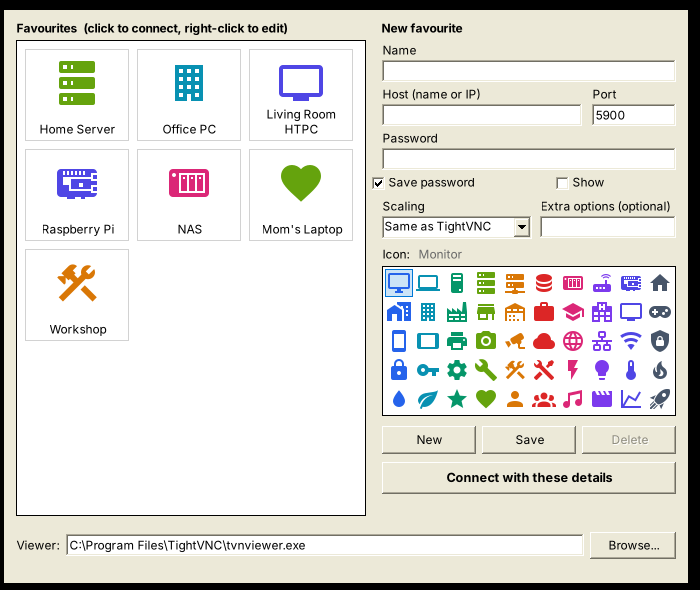

# VNC Favourites

A small Windows launcher that adds **favourites** and **saved passwords** to
[TightVNC](https://www.tightvnc.com/) Viewer 2.x. Each favourite is a button with an icon:
click it and TightVNC Viewer opens, already connected.

## Features
- Favourites shown as icon buttons; choose from 50 icons.
- Saved passwords, encrypted with your Windows login (DPAPI).
- Uses the same display settings TightVNC remembers for each server, with a per-favourite
  scaling override.
- One small `.exe`, no install. Works with the TightVNC Viewer you already have.

## Download
Get the latest `VNCFavourites-<version>-win.zip` from
[Releases](https://github.com/MinnowKnight/vnc-favourites/releases), unzip it and run
`VNCFavourites.exe`. Each release lists SHA-256 checksums in `SHA256SUMS.txt`.

## Requirements
- Windows 10 or 11 (or Windows 7/8.1 with .NET Framework 4.5 or later).
- TightVNC Viewer 2.x (`tvnviewer.exe`). It's found automatically in the usual install folders;
  otherwise use **Browse...** once.

## Using it
1. Run `VNCFavourites.exe`.
2. Enter a name, host, port and password, pick an icon, and press **Save**.
3. Click a favourite's button to connect. Right-click it to edit, reorder or delete.

Extra TightVNC options (for example `-fullscreen=yes` or `-viewonly=yes`) can be added per favourite.

## Security
- **Stored passwords** are encrypted with Windows DPAPI for your user account, in
  `%APPDATA%\VNCFavourites\favourites.xml`. Copying the file to another PC or account doesn't
  reveal them. Like a browser's saved passwords, they can be read by programs running as you.
- **When connecting**, the password is never put on the command line. It's written, in TightVNC's
  own scrambled format, to a temporary file in your Temp folder, which only your account can read.
  The file is overwritten and deleted as soon as the viewer has started.
- **VNC protocol limits:** standard VNC authentication only uses the first 8 characters of a
  password, and VNC traffic isn't encrypted. Use it on networks you trust, or over a VPN or SSH tunnel.

## Uninstalling
VNC Favourites doesn't install anything. To remove it completely:
1. Delete `VNCFavourites.exe`.
2. Delete the folder `%APPDATA%\VNCFavourites` (your saved favourites and passwords).

## Privacy policy
This program will not transfer any information to other networked systems unless specifically
requested by the user or the person installing or operating it. It only starts TightVNC Viewer
with the connection you choose, and stores its settings on your own PC.

## Code signing policy
Free code signing provided by [SignPath.io](https://about.signpath.io),
certificate by [SignPath Foundation](https://signpath.org).

- Committers and reviewers: [MinnowKnight](https://github.com/MinnowKnight)
- Approvers: [MinnowKnight](https://github.com/MinnowKnight)

Every signed release is built from this repository by the
[Release workflow](.github/workflows/release.yml) on GitHub Actions and approved manually
before signing.

## Building from source
On Windows, run `build.cmd`. It uses the C# compiler included with Windows, so no Visual Studio
is needed. The result is `dist\VNCFavourites.exe`.
On Linux or macOS with Mono, run `./build.sh`.

### Making a release (maintainers)
1. Update the version in `src/VNCFavourites.cs` (`AssemblyVersion`, `AssemblyFileVersion`,
   `AssemblyInformationalVersion`) and add a section for it to `CHANGELOG.md`.
2. Merge to `main`.
3. Go to **Actions > Release > Run workflow**. It builds the app, signs it once SignPath is
   configured, and publishes the GitHub release with the zip and checksums.

## Licence
MIT, see [LICENSE](LICENSE). Icons are Material Design Icons by Pictogrammers, Apache 2.0; see
[THIRD-PARTY-NOTICES.md](THIRD-PARTY-NOTICES.md).

TightVNC is a trademark of GlavSoft LLC. This project isn't affiliated with or endorsed by GlavSoft.
